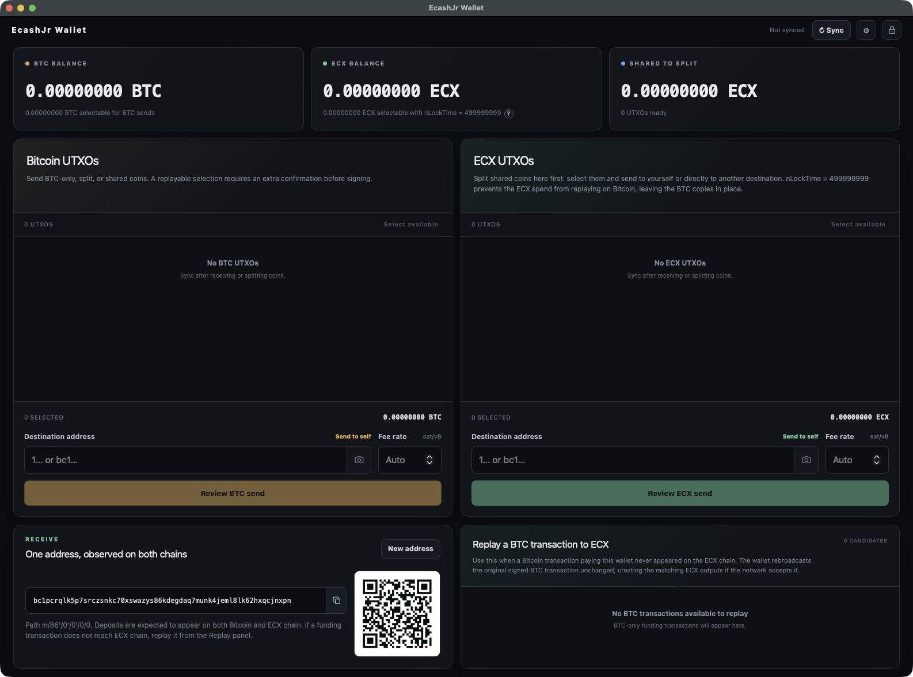

# EcashJr Wallet

EcashJr Wallet is a BIP86 Taproot wallet for Bitcoin and the eCash (ECX) Bitcoin fork. It displays
coins on both chains, splits shared coins with `nLockTime` replay protection, and lets each side be
spent independently.



Both chains use standard Taproot `SIGHASH_DEFAULT` signatures. Every locally signed ECX send and
split uses `nLockTime = 499999998` and `nSequence = 0xfffffffd` on every input. BTC sends retain
chain-tip locktime.

## Features

- Create a new 12-word BIP39 recovery phrase or restore an EcashJr wallet. Reusing a phrase from
  another wallet is supported but not recommended.
- BIP86 receive addresses derived from `m/86'/0'/0'/0/i`.
- Local password protection using scrypt and XChaCha20-Poly1305.
- Independent Bitcoin and ECX Esplora backends, balances, fee settings, and UTXO selection.
- Separate BTC and ECX confirmation targets (both default to 1) and address gap. The ECX target also
  determines when a split counts as confirmed replay protection.
- Chain-specific coins (BTC / ECX, default), sats, or
  [BIP177](https://github.com/bitcoin/bips/blob/master/bip-0177.mediawiki) display units.
- Ordinary sends use sweep-only Taproot transactions with RBF (BTC chain-tip locktime; ECX fixed
  replay-protection locktime). Every selected UTXO is consumed in full; after fees, everything goes
  to one destination with no change output.
- P2PKH, P2TR, P2WPKH, and P2WSH destinations.
- ECX splitting with `nLockTime = 499999998`. Send shared coins to yourself or another destination
  to move only their ECX copies while leaving the Bitcoin outpoints in place.
- Bitcoin-first spending with an explicit warning whenever replay protection is not guaranteed.
- Replay of a Bitcoin funding transaction from the replay panel when its wallet output has not
  appeared on ECX.
- Durable recovery for locally signed transactions whose broadcast or confirmation is uncertain.
- A Deno Desktop application and a local-browser fallback.

## Transaction safety

The wallet keeps current observations from both chains, permanent shared-coin provenance, and a
record of every locally signed transaction. Balances and selectable coins are derived from those
facts rather than stored as separate state.

Before broadcasting, the complete signed transaction is saved to disk. A network or backend error is
treated as an unknown broadcast result, never as proof that the transaction failed. The wallet
retains the transaction and reserves its inputs until it can be verified, rebroadcast, or safely
abandoned.

Final confirmation refreshes the selected coins on both chains, checks relevant pending
transactions, rebuilds the transaction, signs locally, verifies every signature, and broadcasts only
through the selected chain's backend. Both backends must pass their expected fork checkpoint before
their chain identity is trusted.

The replay-protection rule is pinned to ECX mainnet node commit
[`c8474e0b4f2be9b470c46598a5a6a3e55a85b765`](https://github.com/ecash-com/bitcoin/blob/c8474e0b4f2be9b470c46598a5a6a3e55a85b765/src/consensus/tx_verify.cpp).
Its `IsFinalTx` exempts `LOCKTIME_THRESHOLD - 2` from the normal locktime check. At least one input
must be non-final for Bitcoin to enforce the future locktime. Bitcoin then treats 499999998 as a
future block height and rejects the transaction as non-final. 500000000 is a timestamp and is not a
substitute. This protection does not make ordinary BTC transactions unreplayable onto ECX, and is
subject to the chains' current consensus rules.

The marker is checked after signing, while validating persisted ECX spend intents, and immediately
before broadcast/rebroadcast. Funding replay intentionally broadcasts the original BTC bytes;
re-signing them would change the transaction ID and the outputs being recovered.

The original BPUB/spammer feature, its RPC endpoints, codec, publishing keys, and transaction
workflows have been removed. BLAKE signature hashing and the source project's LND helper have also
been removed. The original project and its wallet data are untouched. Do not copy its wallet state
files into this app; recovery uses the BIP39 phrase and scans the new chain pair.

## Run locally

Install [Deno 2.9 or newer](https://docs.deno.com/runtime/desktop/) and then:

```bash
deno install
deno task dev
```

When using the browser fallback, open the private `http://127.0.0.1:<port>/#rpc=...` URL printed by
the process. Browser mode uses a fresh OS-assigned port by default; set `PORT` only when a fixed
port is required. The random fragment authenticates that browser tab to the loopback wallet RPC.

Wallet files are stored in `%APPDATA%\ecashjr-wallet` on Windows, `$XDG_DATA_HOME/ecashjr-wallet`
when configured, `~/.local/share/ecashjr-wallet` on Linux, and
`~/Library/Application Support/ecashjr-wallet` on macOS. Set `ECASHJR_DATA_DIR` to override the
location. Only one wallet process can use a data directory at a time.

Build the native desktop package:

```bash
deno task desktop
```

On macOS this creates `dist/macos/EcashJr Wallet.app` and `dist/macos/EcashJr Wallet.dmg`. Local
builds use ad-hoc signing, so contributors do not need an Apple Developer account. The app includes
the runtime and camera entitlements in both signing modes. For an official release, provide your
Developer ID identity:

```bash
MACOS_CODESIGN_IDENTITY="Developer ID Application: Company Name (TEAMID)" deno task desktop
```

That signs both the app and DMG with Developer ID; the DMG is the artifact intended for
distribution. On Windows the task creates `dist/windows/EcashJr Wallet`, and on Linux it creates
`dist/linux/ecashjr-wallet.AppImage`.

The Linux WebView build uses the system's GTK 3 and WebKitGTK 4.1 libraries; on Debian or Ubuntu
these are provided by `libgtk-3-0` and `libwebkit2gtk-4.1-0`. An AppImage downloaded from the web
may need to be made executable before launching. Building the AppImage locally also requires
`squashfs-tools`, which applies the Linux compatibility launcher after Deno creates the package.

### Linux: blank or black window

The AppImage automatically selects GTK's X11 backend through XWayland when launched from a Wayland
session, including sessions that export `GDK_BACKEND=wayland` globally. This avoids a WebKitGTK
native-Wayland failure that can produce a black window and unbounded renderer memory use. It does
not change the desktop session or global settings.

To test native Wayland explicitly, override the packaged default for one launch:

```bash
ECASHJR_NATIVE_WAYLAND=1 GDK_BACKEND=wayland ./ecashjr-wallet.AppImage
```

Replace the filename with your downloaded AppImage's name. Native Wayland may still show the black
window on affected WebKitGTK versions. When XWayland is unavailable, the launcher leaves GTK's
backend selection unchanged rather than forcing an unreachable X11 display.

## Publishing a release

The **Release** workflow is started manually from GitHub Actions. It validates the project, bumps
the selected patch, minor, or major version, and builds these artifacts in parallel:

- A Developer ID-signed and notarized macOS arm64 DMG.
- An unsigned Windows x64 portable ZIP.
- A Linux x64 AppImage.

Dry run is enabled by default. It performs the complete build and notarization without committing
the version, creating a tag, or publishing a GitHub Release. Its files are available as workflow
artifacts. A non-dry run commits both version manifests to `master`, creates a `v<version>` tag, and
publishes the files and SHA-256 checksums to a GitHub Release. If publication is interrupted after
the tag is pushed, rerunning the failed job resumes the matching tag and draft release instead of
incrementing again.

Configure these GitHub Actions repository secrets before running the workflow:

- `MACOS_CERTIFICATE_BASE64`: the Developer ID Application certificate and private key exported as a
  password-protected `.p12`, then Base64 encoded.
- `MACOS_CERTIFICATE_PASSWORD`: the `.p12` export password.
- `APPLE_ID`: the Apple Developer account email used for notarization.
- `APPLE_APP_SPECIFIC_PASSWORD`: an app-specific password for that Apple ID.
- `APPLE_TEAM_ID`: the Apple Developer Team ID.

The repository's workflow token also needs read and write access to repository contents so it can
push the release commit and tag. Windows code signing is separate from Apple signing and is not yet
configured; consequently, Windows may show a SmartScreen warning.

## Verification

```powershell
deno task check
deno task lint
deno task test
deno task ui:build
```

The test suite covers replay-protection marker validation and standard BIP341 signatures,
BIP39/BIP86 derivation, encrypted secret storage, coin policy, Bitcoin and ECX signing, supported
destinations, multi-input transactions, dual-chain synchronization, replay handling, and
reorganization recovery.

## Important safety notes

- Start with a small test amount and confirm the complete split and spend flow before depositing
  meaningful funds.
- An address can be recognized by both chains, but a transaction appearing on Bitcoin does not
  guarantee that it also exists on ECX.
- Split shared coins by spending the ECX copy first. `nLockTime = 499999998` prevents that
  transaction from being replayed on Bitcoin and leaves the Bitcoin copy untouched.
- Spending Bitcoin first can expose the same transaction on ECX. When protection is not guaranteed,
  the wallet explains the risk and requires explicit acknowledgement before signing.
- Replaying a funding transaction broadcasts the complete original Bitcoin transaction unchanged,
  including every input and output. ECX may reject it if any input is unavailable or invalid there.
- Each configured Esplora backend is trusted as the source of current state for its chain. Backend
  URLs require HTTPS, except for explicit loopback hosts such as `localhost` and `127.0.0.1`.
- `wallet.json` contains public addresses and chain state. Seed material is encrypted in
  `secret.json` and is never sent to either backend.
- Restoration scans only the BIP86 path. Reusing a seed from another wallet is supported but not
  recommended, and the same seed should not be operated concurrently in multiple wallets.
- OS keychain integration is not included in this version.

## Backend access

There is no automatic polling. Backend requests occur only when the user syncs, confirms a
transaction, inspects or replays funding, or starts a full rescan. Recovery processes at most 25 new
addresses per Sync and saves its progress. Final transaction confirmation performs fresh safety
checks even when the dashboard was recently synchronized.

Requests are not retried automatically, including after HTTP 429. Wait for the backend's
`Retry-After` period when provided, then use Sync or retry the action.

This wallet is new software. Start with small amounts and do not use it with irreplaceable funds.
